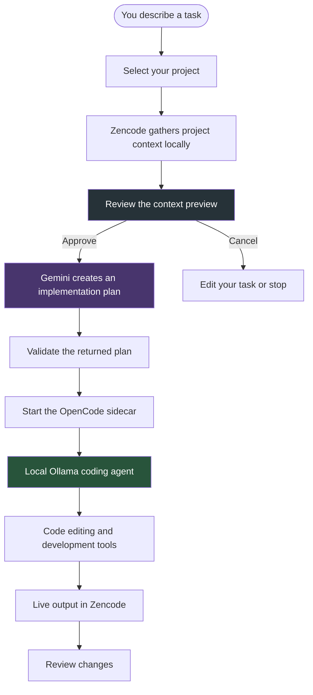

# Zencode

<div align="center">

**Your AI coding workspace. Your machine. Your rules.**

A free-first, local-first desktop app that combines cloud-powered planning with local AI coding.

Built for Windows 11.

[](https://microsoft.com/windows)
[](https://tauri.app)
[](https://rust-lang.org)
[](https://react.dev)
[](https://ollama.com)
[](LICENSE)

</div>

---

## What is Zencode?

Zencode is a desktop application for developers who want AI assistance without handing their entire development workflow over to cloud services.

It uses two AI models, each with a specific job:

| | Planner | Coding Agent |
|---|---|---|
| **Provider** | Google Gemini | Ollama |
| **Model** | Gemini 3.5 Flash-Lite | Qwen 2.5 Coder 7B |
| **Runs** | In the cloud | On your machine |
| **Job** | Understand your task and create an implementation plan | Write code, edit files, and run development tools |

Here's the idea:

1. **You describe a task.** Tell Zencode what you want to build, fix, or change.
2. **You review the context.** Zencode gathers relevant project information and shows you exactly what it plans to send to Gemini.
3. **Gemini creates a plan.** After you approve the request, Gemini returns a structured implementation plan. It doesn't touch your code.
4. **Your local agent gets to work.** OpenCode runs locally through Ollama, following the plan and handling the actual development work.
5. **You review the results.** Review the generated work and, as the project develops, use the planned Git diff review workflow before merging changes.

**The important distinction:** Gemini plans. Your local agent codes. Your source code stays on your machine during the normal workflow.

## Why Zencode?

Most AI coding tools rely heavily on cloud-hosted models. Zencode takes a different approach.

- **Local-first coding:** Code generation, file editing, and build-related work run through your local Ollama model.
- **No paid API requirement in the normal workflow:** Planning uses Gemini's free tier, subject to Google's availability and usage limits.
- **You control what gets shared:** Review the exact planning context before sending anything to Gemini.
- **No automatic cloud fallback:** If your local worker is unavailable, Zencode reports the problem instead of silently switching to a cloud coding model.
- **Keep your existing tools:** Zencode uses OpenCode as its coding-agent engine rather than reinventing one.
- **Native desktop experience:** A Windows desktop application, not another browser tab or VS Code extension.

---

## How it works

Zencode keeps planning and coding separate.



### What actually leaves your machine?

There is one intentional cloud interaction: the planning request.

Before that request is sent, Zencode assembles a context package containing relevant project information, such as:

- A shallow overview of your project structure.
- Supported project manifests, such as `package.json` and `Cargo.toml`.
- Your current Git branch and working-tree status.
- Your task description.

Zencode checks the package for sensitive files, including `.env` files and credentials, and presents the assembled context for your review.

**Nothing is sent to Gemini until you explicitly approve the request.**

Your code-editing and local build workflow is handled by the local agent, not Gemini.

---

## Built with

Zencode uses a fairly straightforward desktop stack:

| Technology | What it does |
|---|---|
| [Tauri 2](https://tauri.app) | Desktop application shell and native integration |
| [React 18](https://react.dev) | Application interface |
| [TypeScript](https://www.typescriptlang.org) | Frontend types and application logic |
| [Vite 6](https://vite.dev) | Frontend development and builds |
| [Rust 2021](https://rust-lang.org) | Core application logic and security |
| [Tokio](https://tokio.rs) | Asynchronous tasks and process management |
| [Gemini](https://ai.google.dev) | Cloud-based task planning |
| [Ollama](https://ollama.com) | Local AI inference |
| [Qwen 2.5 Coder 7B](https://ollama.com) | Local coding model |
| [OpenCode](https://opencode.ai) | Coding-agent engine |
| Git | Version control and change management |

### A little more about the architecture

The Rust backend owns the important stuff:

- Starting, monitoring, and stopping the OpenCode process.
- Managing project state and Git operations.
- Sending planning requests to Gemini.
- Retrieving credentials from Windows Credential Manager.
- Enforcing which AI provider can handle each operation.
- Streaming worker output to the frontend.

React handles the interface, while Rust enforces the actual application rules. The frontend cannot override the backend's provider restrictions.

---

## Security and privacy

Zencode is designed around a few strict boundaries.

### 1. Separate AI responsibilities

| Operation | Where it runs |
|---|---|
| Initial implementation planning | Gemini |
| Writing and editing code | Local Ollama |
| Refactoring | Local Ollama |
| Compiler-error repair | Local Ollama |
| Build and test operations | Local Ollama |

The local coding worker does not fall back to Gemini or another cloud provider.

### 2. API keys stay out of the frontend

Your Gemini API key is stored in Windows Credential Manager.

Rust retrieves it when needed. It is not exposed to:

- React application state.
- Browser local storage.
- Frontend developer tools.
- Application log files.
- Child-process environment variables.

### 3. You approve cloud requests

Before a planning request is made:

1. Zencode builds the context package locally.
2. The package is checked for sensitive files.
3. You see the exact content that will be submitted.
4. You explicitly approve the request.

The Rust backend also checks for explicit confirmation before sending it. Simply calling the frontend command is not enough.

### 4. Local agent communication

The OpenCode sidecar communicates over localhost (`127.0.0.1`) and uses a randomly generated per-process authentication token.

### 5. Safer Git operations

Git commands are executed through the native Git CLI using argument arrays rather than constructing shell command strings.

---

## Project structure

You don't need to understand every folder to use Zencode, but here's where things live:

```text
ZenCode/
├── crates/
│   └── zencode-core/
│       └── src/
│           ├── lib.rs
│           ├── routing.rs       # AI provider restrictions
│           ├── planner.rs      # Gemini requests and plan validation
│           └── security.rs     # Credential handling and redaction
│
├── apps/
│   └── desktop/
│       ├── src/                 # React + TypeScript frontend
│       │   ├── App.tsx
│       │   ├── types/
│       │   ├── lib/
│       │   ├── styles/
│       │   └── components/
│       │
│       └── src-tauri/           # Rust desktop backend
│           ├── src/
│           │   ├── main.rs
│           │   ├── lib.rs
│           │   ├── state.rs
│           │   ├── models.rs
│           │   ├── engine.rs
│           │   └── commands/
│           └── binaries/
│
├── tests/
│   └── engine-contract/         # Engine boundary tests
│
├── Cargo.toml
├── zencode-master-spec.md
└── .gitignore
```

**Where should you look?**

- `apps/desktop/src/` — The interface and React components.
- `apps/desktop/src-tauri/src/` — Desktop application logic.
- `crates/zencode-core/` — Shared planning, routing, and security logic.
- `tests/` — Tests for the application engine.

---

## Getting started

Zencode is currently built for Windows 11 (64-bit).

### Prerequisites

Install the following before building:

| Requirement | Version / Notes |
|---|---|
| Windows | Windows 11 x64 |
| Rust | 1.80 or newer |
| Node.js | 20 or newer |
| pnpm | Package manager |
| Ollama | Windows installation |
| Git | Available in your PATH |
| Gemini API key | Google AI Studio free-tier key |

You'll also need the pinned OpenCode v1.19.5 executable.

### 1. Clone the repository

Open PowerShell:

```powershell
git clone https://github.com/rKyzen-Labs/ZenCode.git
cd ZenCode
```

### 2. Install the local coding model

Install [Ollama](https://ollama.com) and download the required model:

```powershell
ollama pull qwen2.5-coder:7b
```

Make sure Ollama is running before launching Zencode.

### 3. Set up your Gemini API key

Get an API key from [Google AI Studio](https://aistudio.google.com).

Store it in Windows Credential Manager:

```powershell
cmdkey /generic:zencode:gemini_api_key /user:zencode /pass:YOUR_GEMINI_API_KEY
```

Replace `YOUR_GEMINI_API_KEY` with your actual key.

### 4. Install OpenCode

Download the official [OpenCode v1.19.5 release](https://github.com/anomalyco/opencode/releases/tag/v1.19.5).

Extract `opencode.exe` into:

```text
apps/desktop/src-tauri/binaries/opencode.exe
```

The expected SHA-256 checksum is:

```text
09A6E693157F0887E504F2CF4357A8CBDDC5EAD5D0DFFB9A269DCC47C48640F5
```

For Windows GNU targets, name the executable:

```text
opencode-x86_64-pc-windows-gnu.exe
```

### 5. Install frontend dependencies

```powershell
cd apps/desktop
pnpm install
```

### 6. Run the tests

From the repository root:

```powershell
cargo test --workspace
```

The existing test suite includes checks for:

- AI provider routing restrictions.
- Secret redaction.
- Windows Credential Manager integration.
- Rejection of unconfirmed planning requests.

### 7. Launch Zencode

Start the development version:

```powershell
cd apps/desktop
pnpm tauri dev
```

Build the frontend:

```powershell
pnpm build
```

Or create a release desktop application:

```powershell
pnpm tauri build
```

---

## Development status

Zencode is being developed in milestones. Here's what's implemented and what's still planned.

<details>
<summary><strong>✅ Milestone 0 — Engine boundary verification</strong></summary>

- OpenCode v1.19.5 pinned with a SHA-256 checksum.
- Windows Credential Manager integration.
- Offline Ollama failure handling.
- No cloud fallback when the local worker is unavailable.
- Clean handling of Gemini quota errors.
- No provider fallback when planning fails.

</details>

<details>
<summary><strong>✅ Milestone 1 — Desktop foundation</strong></summary>

- Tauri 2 desktop application.
- React 18 + TypeScript + Vite 6 frontend.
- Rust backend and application state management.
- Project selection and workspace screens.
- Planning context preview.
- Explicit confirmation before cloud planning requests.
- Gemini planning integration and structured-plan validation.
- OpenCode sidecar process management.
- Real-time worker output streaming through SSE.
- Task and status interfaces.
- Sidecar cleanup when the application closes.

</details>

<details>
<summary><strong>🚧 Milestone 2 — Git isolation and diff review</strong></summary>

Planned:

- Isolated Git worktrees for individual tasks.
- Worktree storage under `.zencode/worktrees/`.
- CodeMirror 6 diff-review interface.
- A safer review process before changes are merged.

</details>

<details>
<summary><strong>📋 Milestone 3 — Build verification and permission gates</strong></summary>

Planned:

- File watching through the `notify` crate.
- Local build verification.
- Automated build-error feedback.
- Permission gates for sensitive development operations.

</details>

---

## License

Zencode is open-source software licensed under the [MIT License](LICENSE).

