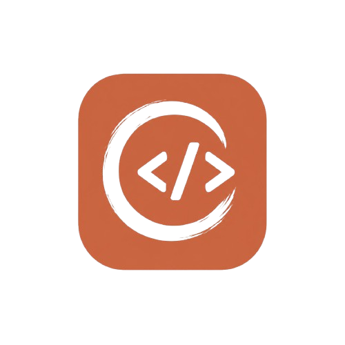
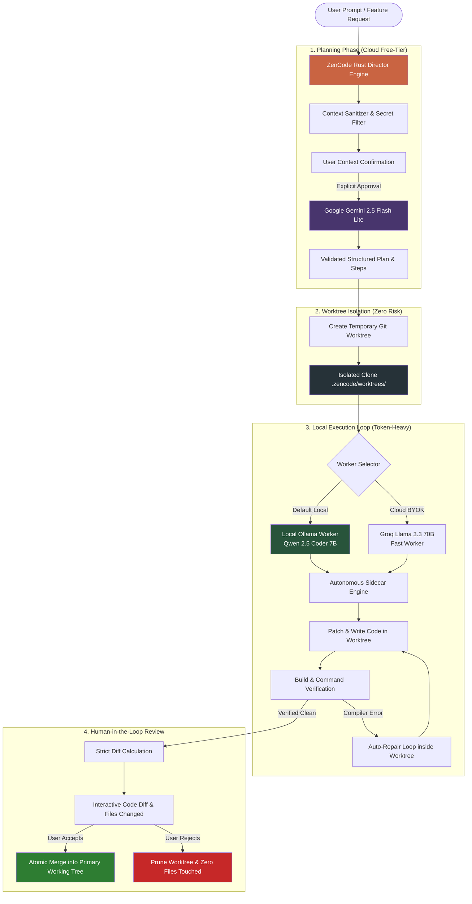

# ZenCode

<div align="center">



# ZenCode
**Your AI coding workspace. Your machine. Your rules.**

A free-first, privacy-first, local-first AI coding desktop application that combines free cloud planning with local autonomous agent execution in isolated Git worktrees.

[](https://github.com/rKyzen-Labs/ZenCode/releases/latest)
[](https://github.com/rKyzen-Labs/ZenCode/releases)
[](https://github.com/rKyzen-Labs/ZenCode/stargazers)
[](LICENSE)

<br />

[](https://github.com/rKyzen-Labs/ZenCode/releases/latest)
[](https://github.com/rKyzen-Labs/ZenCode/releases/latest)
[](https://tauri.app)
[](https://rust-lang.org)
[](https://react.dev)
[](https://ollama.com)

<br />

### ⭐ If you find ZenCode useful, please consider [giving it a star on GitHub](https://github.com/rKyzen-Labs/ZenCode)! It directly helps support development.

</div>

---

## 📥 Download ZenCode

Get the latest release for your platform:

| Platform | Download | Package Description |
| :--- | :--- | :--- |
| **Windows 10 / 11** | [**⬇️ Download Windows Installer (.exe)**](https://github.com/rKyzen-Labs/ZenCode/releases/download/v0.1.0/Zencode_0.1.0_x64-setup.exe) | NSIS Setup installer with auto WebView2 bootstrapper (5.80 MB) |
| **Ubuntu / Debian** | [**⬇️ Download Debian Package (.deb)**](https://github.com/rKyzen-Labs/ZenCode/releases/download/v0.1.0/Zencode_0.1.0_amd64.deb) | Native Debian package with auto-resolved GTK/WebKit dependencies (9.33 MB) |
| **Linux (All Distros)** | [**⬇️ Download Linux Standalone Binary**](https://github.com/rKyzen-Labs/ZenCode/releases/download/v0.1.0/zencode-linux-x86_64) | Standalone 64-bit ELF binary — no installer needed (22.88 MB) |

> 💡 *Looking for all releases and source code? View the [GitHub Releases Page](https://github.com/rKyzen-Labs/ZenCode/releases).*

---

## 🎯 What Problem Does ZenCode Solve?

**ZenCode is designed to solve three critical flaws in the current ecosystem of AI coding assistants like Cursor, Windsurf, or GitHub Copilot:**

### 1. 💸 Cost and API Rate Limits
Commercial AI coding tools lock developers into **\$20/month subscriptions** or rapidly burn through personal API quotas by sending every minor compiler error, token-heavy file patch, and test output to an expensive cloud model.

**How ZenCode solves this:**  
ZenCode uses a **Master-Worker architecture**. It limits cloud usage by using a free-tier API (like Google Gemini 2.5 Flash Lite) strictly for high-level architectural planning, while routing the repetitive, token-heavy file-patching and repair loops to a **free, local model** (like Qwen 2.5 Coder 7B or Granite 8B running through Ollama) or a manual "Heavy Mode" via Groq BYOK.

### 2. 🔒 Privacy and Telemetry
Developers working on proprietary codebases are often forced to send their entire workspace context to centralized servers with opaque data retention policies and training terms.

**How ZenCode solves this:**  
ZenCode operates on a **zero-telemetry, Bring-Your-Own-Key (BYOK)** model. The user controls exactly what leaves their machine, routing logic is handled locally by the native Rust backend, and code execution defaults to your local hardware. No private source code is stored on third-party servers.

### 3. 🛡️ Destructive Autonomous Execution
When standard AI agents hallucinate, generate bugs, or write bad logic, they directly overwrite project files on disk, potentially corrupting the working directory, breaking build setups, and requiring messy Git resets.

**How ZenCode solves this:**  
ZenCode enforces **Git Worktree Isolation**. The autonomous coding engine writes code and runs test builds inside a hidden, temporary clone of the repository. ZenCode then calculates a strict diff, ensuring **no file on the user's actual hard drive is touched** until the user explicitly reviews, inspects the diff, and approves the patch.

---

## 🏗️ Master-Worker Architecture

ZenCode separates high-level cognitive planning from token-heavy low-level file edits.



---

## ✨ Features at a Glance

| Feature | What It Does | Why It Matters |
| :--- | :--- | :--- |
| **Dual AI Pipeline** | Gemini plans, local Ollama codes | Enjoy high-IQ cloud architecture plans without burning your cloud token budget |
| **Git Worktree Isolation** | AI works in an isolated sandbox clone | Hallucinations and bad edits never damage your active code or uncommitted changes |
| **Strict Grounded Diff** | Side-by-side file review before apply | You verify every line of code before anything touches your primary repository |
| **Permission-Gated Commands** | Every terminal execution requires approval | AI cannot run rogue scripts, delete directories, or install dependencies without consent |
| **Interactive Terminal Streaming** | Real-time terminal output in the side panel | Watch builds, tests, and command outputs live with ANSI color support |
| **Rich Markdown Rendering** | Tables, copyable code blocks, headings, bold | AI answers and exploration summaries render beautifully formatted |
| **Customizable Keyboard Shortcuts** | Set custom keybindings for tabs, search, etc. | Tailor your navigation and workflow speeds to your preference |
| **Zero Telemetry & BYOK** | Keys stored in local secure keystore | Your proprietary codebase stays 100% private |

---

## 🚀 Quick Start Guide

### Option A: Install from Binary (Recommended)

#### 🪟 Windows (10 / 11)
1. Download [`Zencode_0.1.0_x64-setup.exe`](https://github.com/rKyzen-Labs/ZenCode/releases/download/v0.1.0/Zencode_0.1.0_x64-setup.exe).
2. Run the installer and launch ZenCode.
3. Install [Ollama](https://ollama.com) and pull the recommended coding model:
   ```powershell
   ollama pull qwen2.5-coder:7b
   ```
4. Enter your free-tier Gemini API key in the onboarding wizard (or via Google AI Studio).

#### 🐧 Linux (Ubuntu / Debian)
1. Download [`Zencode_0.1.0_amd64.deb`](https://github.com/rKyzen-Labs/ZenCode/releases/download/v0.1.0/Zencode_0.1.0_amd64.deb).
2. Install via apt:
   ```bash
   sudo apt install ./Zencode_0.1.0_amd64.deb
   ```
3. Run `zencode` from your terminal or application launcher.

#### ⚙️ Linux (Standalone Executable)
```bash
wget https://github.com/rKyzen-Labs/ZenCode/releases/download/v0.1.0/zencode-linux-x86_64
chmod +x zencode-linux-x86_64
./zencode-linux-x86_64
```

---

### Option B: Build from Source

#### Prerequisites
- **Rust**: 1.80+ (`rustup default stable`)
- **Node.js**: 20+ (`corepack enable`)
- **pnpm**: 9+ (`pnpm install`)
- **Linux Packages** (Ubuntu only):
  ```bash
  sudo apt-get install -y libwebkit2gtk-4.1-dev libappindicator3-dev librsvg2-dev patchelf libssl-dev libfuse2
  ```

#### Build Instructions
```bash
# 1. Clone the repository
git clone https://github.com/rKyzen-Labs/ZenCode.git
cd ZenCode

# 2. Install dependencies
pnpm install

# 3. Run in development mode
pnpm --filter zencode-desktop tauri dev

# 4. Build release executable / packages
pnpm --filter zencode-desktop tauri build
```

---

## 📂 Repository Structure

```text
ZenCode/
├── apps/
│   └── desktop/                  # Tauri 2 frontend & desktop app
│       ├── src/                  # React 18 + TypeScript application UI
│       │   ├── components/       # ChatThread, FileTreePane, OnboardingWizard, etc.
│       │   └── assets/           # Application icons, logos, styles
│       └── src-tauri/            # Tauri 2 Rust desktop backend
│           ├── src/
│           │   ├── commands/     # Tauri IPC commands & handlers
│           │   ├── db/           # SQLite conversation & history storage
│           │   ├── git/          # Git worktree isolation & diff engine
│           │   └── exec/         # Supervised command execution & job management
│           └── tauri.conf.json   # Multi-platform bundle configuration
│
├── crates/
│   └── zencode-core/             # Core reasoning & planning engine
│       ├── src/
│       │   ├── planner.rs        # Gemini Director planning & quota cascade
│       │   ├── worker/           # Ollama / Groq worker orchestration
│       │   └── security.rs       # Secure keystore & secret sanitization
│
├── tests/
│   ├── engine-contract/          # Engine boundary contract test suite
│   └── task-flow/                # Multi-step task execution & isolation tests
│
└── .github/
    └── workflows/
        └── release.yml           # Multi-platform CI release pipeline
```

---

## 🗺️ Roadmap & Development Milestones

- [x] **Milestone 0: Engine Boundary & Contracts** — Deterministic routing, secret redaction, credential vault, offline Ollama fallback handling.
- [x] **Milestone 1: Desktop Foundation** — Tauri 2 + React 18, dark/light theme, streaming responses, SSE worker connection.
- [x] **Milestone 2: Git Worktree Isolation & Diff Review** — Hidden worktree sandboxes, CodeMirror diff viewer, atomic accept/reject changes.
- [x] **Milestone 3: Grounded Verification & Terminal Integration** — Supervised terminal executions, command approval gates, real-time log stream.
- [x] **Milestone 4: Multi-Platform Release** — Native Windows NSIS installer, Debian `.deb` package, and standalone Linux 64-bit ELF binary.
- [ ] **Milestone 5: macOS Universal Package (.dmg)** — Automated signing and notarization for Apple Silicon and Intel Macs.

---

## 🤝 Contributing

Contributions, issues, and feature requests are welcome!  
Feel free to check out the [issues page](https://github.com/rKyzen-Labs/ZenCode/issues).

1. Fork the Project
2. Create your Feature Branch (`git checkout -b feature/AmazingFeature`)
3. Commit your Changes (`git commit -m 'Add some AmazingFeature'`)
4. Push to the Branch (`git push origin feature/AmazingFeature`)
5. Open a Pull Request

---

## 📜 License

Distributed under the **MIT License**. See [`LICENSE`](LICENSE) for more information.

---

<div align="center">

**Built with ❤️ by [rKyzen Labs](https://github.com/rKyzen-Labs)**

⭐ **Don't forget to star the repo if you like the project!** ⭐

</div>
