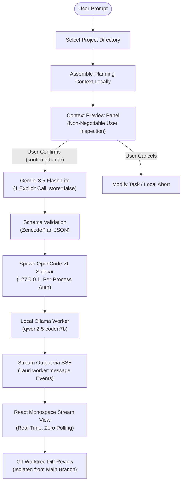

# Zencode

<div align="center">

**A free-first, local-first, AI-assisted development workspace for Windows 11.**

[](https://microsoft.com/windows)
[](https://tauri.app)
[](https://rust-lang.org)
[](https://react.dev)
[-black?logo=ollama&logoColor=white)](https://ollama.com)
[-8E75C4?logo=google&logoColor=white)](https://ai.google.dev)
[](LICENSE)

</div>

---

## What Zencode Is

Zencode is a standalone Windows 11 desktop application (not a browser app, not a VS Code extension) engineered to deliver **useful AI-assisted software engineering with zero paid API spend in the normal workflow**.

It achieves this through a strict architectural split:
1. **The Planner (Cloud, Free-Tier)**: Rust sends **one explicit planning request** per task to Google's Gemini 3.5 Flash-Lite (`gemini-3.5-flash-lite`) using the free tier (`store=false`). Gemini returns a structured JSON implementation plan. Gemini **never** edits code or runs tools.
2. **The Worker (Local-First)**: An unmodified OpenCode v1 sidecar, bound strictly to a local Ollama instance running `qwen2.5-coder:7b`, executes the plan. **All code editing, tool execution, build runs, compiler errors, and repair loops occur entirely on your own machine.**
3. **The User Boundary**: The user reviews a complete, explicit context preview **before** any cloud call is made, and will review a full Git diff before changes touch their working tree.

---

## The Core Workflow



---

## Locked Technology Stack

| Layer | Technology | Locked Role & Constraints |
|---|---|---|
| **Desktop Shell** | Tauri 2 | Native Windows packaging, window lifecycle, and secure IPC |
| **Frontend** | React 18 + TypeScript + Vite 6 | Dark-theme UI, task state, context preview, streaming feed |
| **Backend** | Rust 2021 | Owns all process management, Git operations, credential access, routing, and policy |
| **Async Runtime** | Tokio | Async task scheduling, SSE event streaming, and process supervision |
| **Planner** | Gemini 3.5 Flash-Lite (`gemini-3.5-flash-lite`) | Free-tier cloud planning via Gemini Interactions API. 1 call per task, `store=false` |
| **Local Worker** | Ollama (`qwen2.5-coder:7b`) | Strictly local inference; zero cloud fallback under any circumstance |
| **Agent Engine** | Pinned OpenCode v1 (`v1.19.5`) | Unmodified sidecar on loopback `127.0.0.1` with per-process random token auth |
| **Credentials** | Windows Credential Manager | Key stored securely in OS credential store; never exposed to React or child processes |
| **Git Integration** | Native Git CLI | Argument array invocation only — zero string concatenation into shell commands |

---

## Architectural & Security Boundaries

### 1. The Strict Routing Matrix
Zencode enforces routing at the Rust layer. AI operations can only go to their designated provider:

| Operation | Approved Provider | Forbidden Fallbacks |
|---|---|---|
| **Create Initial Plan** | Gemini 3.5 Flash-Lite | Local Worker, Cloud Workers |
| **Code Edits & Refactoring** | Ollama Local Worker | Gemini, OpenAI, Any Cloud Provider |
| **Compiler Error Repair** | Ollama Local Worker | Gemini, OpenAI, Any Cloud Provider |
| **Test Execution & Build Verification** | Ollama Local Worker | Gemini, OpenAI, Any Cloud Provider |

### 2. Zero Secrets Leakage
- The Gemini API key is loaded on-demand from Windows Credential Manager inside the Rust IPC command handler.
- The key is **never** serialized to React frontend state, localStorage, devtools, log files, or passed to child process environments.

### 3. Non-Negotiable Context Preview
Before any byte leaves your machine:
- Rust inspects the project shallow tree, manifests (`package.json`, `Cargo.toml`), Git branch/status, and task description.
- Rust asserts that zero `.env`, credentials, or private files are present in the package.
- The frontend renders the exact assembled payload.
- The IPC command `submit_plan_request` strictly checks `confirmed == true` in Rust before dispatching. Requests cannot be bypassed or automated.

---

## Repository Structure

```
ZenCode/
├── .gitignore                          # Excludes build artifacts and large binaries
├── Cargo.toml                          # Workspace root manifest
├── zencode-master-spec.md              # Complete locked V1 architecture specification
├── crates/
│   └── zencode-core/                   # Core business logic crate
│       ├── Cargo.toml
│       └── src/
│           ├── lib.rs
│           ├── routing.rs              # Enforced typed routing matrix
│           ├── planner.rs              # Gemini Interactions API client & schema validator
│           └── security.rs             # Windows Credential Manager & secret redaction
├── apps/
│   └── desktop/                        # Tauri 2 + React desktop application
│       ├── package.json
│       ├── vite.config.ts
│       ├── src/                        # React 18 + TypeScript frontend
│       │   ├── App.tsx                 # Main application controller
│       │   ├── types/index.ts          # Typed models matching Rust structs
│       │   ├── lib/ipc.ts              # Typed Tauri IPC & event listeners
│       │   ├── styles/globals.css      # Dark-first restrained design system
│       │   └── components/
│       │       ├── WelcomeScreen.tsx   # Project picker & engine readiness indicators
│       │       ├── WorkspaceScreen.tsx # Active project banner & task prompt input
│       │       ├── TaskView.tsx        # Context preview, plan display, streaming worker
│       │       └── StatusBar.tsx       # Bottom status bar (branch, health, requests)
│       └── src-tauri/                  # Rust Tauri backend
│           ├── Cargo.toml
│           ├── tauri.conf.json         # Tauri 2 window & security capabilities
│           ├── build.rs                # Windows manifest configuration (ComCtl6)
│           ├── binaries/
│           │   └── opencode-version.txt # Pinned OpenCode v1.19.5 release metadata
│           └── src/
│               ├── main.rs             # Application entrypoint
│               ├── lib.rs              # Tauri builder & window lifecycle hooks
│               ├── state.rs            # AppState (project, supervisor, planner, task)
│               ├── models.rs           # Shared serialization models
│               ├── engine.rs           # OpenCode sidecar process supervisor
│               └── commands/mod.rs     # Tauri IPC commands (open_project, submit_plan, etc.)
└── tests/
    └── engine-contract/                # M0 engine boundary & failure-mode smoke tests
```

---

## Prerequisites

To build and run Zencode on Windows 11:

1. **Operating System**: Windows 11 (x64)
2. **Rust Toolchain**: Rust 1.80+ (`stable-x86_64-pc-windows-gnu` or `stable-x86_64-pc-windows-msvc`)
3. **Node.js & Package Manager**: Node.js 20+ and `pnpm`
4. **Ollama**:
   - Install [Ollama for Windows](https://ollama.com).
   - Pull the locked worker model:
     ```powershell
     ollama pull qwen2.5-coder:7b
     ```
5. **Gemini API Key**:
   - Obtain a free-tier API key from [Google AI Studio](https://aistudio.google.com).
   - Store it securely in Windows Credential Manager under the target name `zencode:gemini_api_key`:
     ```powershell
     cmdkey /generic:zencode:gemini_api_key /user:zencode /pass:YOUR_GEMINI_API_KEY
     ```
6. **OpenCode Sidecar Binary**:
   - Download the official pinned OpenCode `v1.19.5` Windows release from GitHub:
     [OpenCode v1.19.5 Release](https://github.com/anomalyco/opencode/releases/tag/v1.19.5)
   - Extract `opencode.exe` into `apps/desktop/src-tauri/binaries/opencode.exe` (SHA256: `09A6E693157F0887E504F2CF4357A8CBDDC5EAD5D0DFFB9A269DCC47C48640F5`).
   - For GNU targets, copy to `opencode-x86_64-pc-windows-gnu.exe`.

---

## Getting Started

### 1. Clone the Repository
```powershell
git clone https://github.com/rKyzen-Labs/ZenCode.git
cd ZenCode
```

### 2. Install Frontend Dependencies
```powershell
cd apps/desktop
pnpm install
```

### 3. Run Backend & Boundary Tests
Execute the full test suite across the workspace:
```powershell
# From workspace root
cargo test --workspace
```
Expected output:
- `routing::tests::test_routing_matrix_enforcement ... ok`
- `security::tests::test_redaction ... ok`
- `security::tests::test_credential_retrieval_from_windows_manager ... ok`
- `commands::tests::test_submit_plan_request_rejects_unconfirmed ... ok`

### 4. Build the Frontend
```powershell
cd apps/desktop
pnpm build
```

### 5. Launch Zencode Desktop
```powershell
# In development mode with live reload:
cd apps/desktop
pnpm tauri dev

# Or build the release binary:
pnpm tauri build
```

---

## Verification & Status

- [x] **Milestone 0: Engine Boundary Verification**
  - Sidecar binary pinned to `v1.19.5` with SHA256 checksum lock.
  - OS Credential Manager integration tested and verified.
  - Offline Ollama failure simulation: cleanly reports unavailable, 0 cloud fallback.
  - Quota error failure simulation: halts planning cleanly, 0 provider fallback.
- [x] **Milestone 1: Desktop Foundation**
  - Tauri 2 shell + React 18 + TypeScript + Vite 6 initialized.
  - Full IPC surface implemented (`open_project`, `preview_planning_context`, `submit_plan_request`, `start_worker_session`, `stop_worker_session`).
  - Strict Rust-enforced context confirmation barrier.
  - Real-time SSE worker event streaming (`worker:message`).
  - Welcome, Workspace, and Task screens with persistent Status Bar.
  - Zero orphaned sidecar processes on window destruction.
- [ ] **Milestone 2: Git Worktree Isolation & Diff Review** *(Upcoming)*
  - Per-task isolated Git worktrees under `.zencode/worktrees/`.
  - CodeMirror 6 diff review surface.
- [ ] **Milestone 3: Self-Healing Build Loop & Permission Gates** *(Upcoming)*
  - File watcher via `notify` crate.
  - Local build verification before merge.

---

## License

This project is licensed under the [MIT License](LICENSE).
